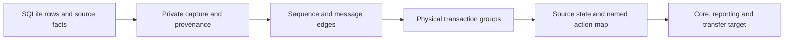

# Close runtime conformance

Full runtime conformance remains open. The code, local tests, and signed dev app
are built. They do not prove the full implementation. Keep the required release
check blocked until the model checks, engine coverage, and real use week pass.

The approved [design](orchestrator-v2/DESIGN.md) and
[acceptance criteria](orchestrator-v2/ACCEPTANCE.md) remain unchanged.
`orchestrator-v2/SNAPSHOT.sha256` fixes those texts. The mutable
[implementation record](orchestrator-v2/IMPLEMENTATION.md) records later rules,
including R43–R50. Do not replace an approved claim with a weaker check.

## Capture actual state

The old compact v1 trace records reducer events, effects, and SHA-256 state
hashes. The opt-in v2 mechanism capture now adds structured SQLite snapshots:
core state, receipts, outbox rows, processed commands, command receipts, stable
thread bindings, and observation facts. Driver rows commit with the SQLite
change. The exporter writes local JSONL; raw rows stay private.

An earlier capture batch with 70 sidecars, including failed-test prefixes, used
134,747,697 raw bytes. Observation snapshots repeat earlier facts and rows, so
capture size can grow quadratically. No seven-day capture capacity check has
passed. This remains a limit of the opt-in verification capture path.

Each `origin.commit` identifies one row. `origin.transaction` identifies the
physical SQLite commit. Several rows can share that transaction. The merger
keeps them together. The mapper uses the current device's internal rows plus
other devices' committed state, and exposes only the final state of the group.
It must not let another device observe a temporary pending interrupt between
an atomic Apply and CompleteEffect.

Provider request identity, session identity, context delivery, reporting loss,
and process death are different facts. A session-start event does not prove
context acceptance. A closed stream does not prove process death. A callback
must keep the issued request and attempt even when approval or dispatch occurs
later. The R50 checker joins the raw issue, route, and accepted question receipt;
a normalized question row alone is insufficient.

The approved schema also calls for canonical BLAKE3 post hashes. The raw v2
snapshot does not claim that field. Keep that schema gap explicit; do not label
a compact SHA-256 hash as BLAKE3. Exact state-image checks do not remove the
remaining schema requirement.

## Check the shipped software

The vendored runtime tools reconstruct state from source facts and check exact
named transitions. The common target requires the core, native reporting, and
request-scoped transfer products. It cannot choose a target successor to make
an unexplained source state pass. Unknown or conflicting hosts, missing source
identities, missing request links, and unsupported observations fail closed.

The normalized vendor package removes Python comment text only. ASTs, token
text and positions remain equal; TLA and original spec bytes remain exact.
Its canonical allowlist records the new hashes. Earlier receipts retain their
original hashes and scope.

Comment removal retains spaces to preserve token positions. The scoped Git
whitespace rule permits that padding only inside the vendored runtime package.
The canonical hashes still cover every byte. Generated Python bytecode stays
outside the package and the commit.

The final package passed all 148 unit tests, including the common-target entry
point and JSON context comparison. A fresh source-bound test passed both its
60-row core/transaction
prerequisite and 63 exact common-target images. That test used one device and a
provider stand-in. It checked physical transaction visibility and the raw
question issuance join. It does not prove every runtime path, arbitrary
executions, fair progress, deployed providers, or a real use week. Earlier
component receipts remain separate.

The latest engine gate passed 54 orchestrator tests, 25 transfer tests, all 68
runtime integrations, and compact replay of 75 recordings. All 547 harness
library tests also passed on unchanged harness source. These tests use provider
stand-ins. [CHECKS.json](orchestrator-v2/CHECKS.json) records the exact local
source and app scope. The manual engine and app receipts are not full-model
provenance and must not be promoted to it after the run.

## Keep the open work explicit

- Bind fresh integration captures to source, binaries, models, and test receipts
  before they run. Derive their context from those exact captured rows. Recheck
  the same inputs before sealing the context. Reject app-only or unbound
  provenance, incomplete groups, foreign contexts, and altered inputs.
- Map every required source path. Current strict failures include absent host
  authority, unsupported observation steps, and missing request or binding
  links. Do not fill those gaps with expected model state or guessed facts.
- Check the joint mechanism relation against the corrected operational target.
  Prove safety and fair progress for the independent system model. Captured
  paths and separate module proofs do not prove this relation in full (AC-P2).
- Check every required engine action, guard in both states, and mutant (AC-I2).
  Driver-only scripts and constructor counts do not prove live callers.
- Check actual deployed Cloud and provider behavior. Local document channels
  and provider stand-ins do not prove those services.
- Collect and validate a real seven-day use window. Synthetic days, copied
  databases, and runner setup do not count as use.

The strict full checker must report the first unsupported boundary and return
failure. Keep those receipts. Never ship a placeholder success or weaken the
release gate to make the build appear complete.
