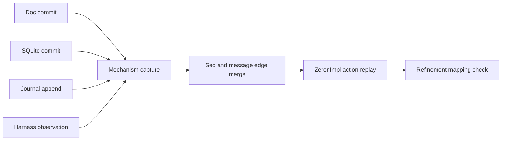

# Close runtime conformance

Full runtime conformance is open. Do not create a passing placeholder checker.
The required `orchestrator-verify` job runs the release check after executable
checks. It fails until full S3, full conformance, and the use week pass. The S3
wrapper is now present; the release gate generates its source from the
vendored Delegation module, checks the inverse transform, then runs fresh
TLAPS obligations. Full runtime conformance and the week remain absent.

The approved design and acceptance snapshots are in
[`orchestrator-v2/DESIGN.md`](orchestrator-v2/DESIGN.md) and
[`orchestrator-v2/ACCEPTANCE.md`](orchestrator-v2/ACCEPTANCE.md). The design ledger
records Tyler's approval on 2026-11-08. `SNAPSHOT.sha256` fixes these imported
texts. Later R25–R42 rules in the task briefs and progress ledger take priority
where the snapshot has older wording. Keep these differences explicit.

## Capture mechanism state

The current row captures a reducer event, effects, and an opaque state hash.
The v1 hash uses SHA-256; the approved schema requests BLAKE3. That
proves neither the SQLite receipt/outbox state nor a synced doc write.
Add a versioned mechanism row at each commit boundary. Keep user text out of
the projection. Assign ids from stable chat and message ids; never infer global
identity from per-device `ThreadId` integers.



| Capture boundary | Capture fields | Model operators |
|---|---|---|
| Commit reducer state and receipt in `Driver::apply_tx` (`driver.rs`) | stable chat id map; host rows; receipt ids; ordered held queue; emitted outbox ids and payload kind; accepted/rejected result; structured pre/post projection | `ZInit`, `DrainPerson`, `DrainTask`, `Delegate`, `ZEndRun`, `IngestNotice`, `DrainQRow`, `DrainClamp` in `ZI_ZeronImpl.tla` |
| Mark processed commands in `Driver::mark_command` and DocHost drain (`driver.rs`, `doc_host.rs`) | ledger row id, row origin, deciding host, replica version read, receipt id, processed mark | `MarkLedger`, `DrainDupRow`; `ZI_ReceiptBeforeMark`; `ZI_PlImpl` replica gates |
| Insert and finish outbox rows (`store::put_outbox`, `store::mark_done`) | effect id, originating command, host, payload kind, durable status; retain pending rows across crash | `obx`, `CreateWrite/CreateMark`, `PublishWrite/PublishMark`, `StopWrite/StopMark` |
| Append remote rows in `OrchWire::transmit` (`remote.rs`) | stable wire id, sender/target chat and host, payload kind, doc ledger vs orch_out, append receipt, replica version | `cmds`, `orchOut`, `qCmd`, `qOut`, `aCmd`; matching write actions |
| Start provider attempt (`OrchWire` start effect handler, `wire.rs`) | chat/run/attempt key, synced-doc gate result and version, journal pre/post seq, start receipt, effective access, actual provider start count | `DispatchRun`, `DispatchMark`, `jr`, `jseq`, `prov`, `dispatches`, `runAcc` |
| Send wait/read reply and observe ToolResult (wire task helpers and session stream) | run/attempt, child/run, reply id, sent flag, observed flag; reset volatile flags on crash | `WaitReply`, `WaitObserved`, `ReadReply`, `ReadObserved`, `DeviceCrash`; `ZI_AckObserved` |
| Apply Stop, question hop, Clamp and restart | chat host, epoch, holder/view/wake sets, access config/received ceiling/live-run access, timer state | `DrainStop`, `IngestQUp`, `IngestQClosed`, `ZStartQuestion`, `ZAgentAnswer`, `ZPersonAnswer`, `ZNarrowAccess`, `DrainClamp` |
| Change device reachability; crash and recover | host id, offline/online transition, cleared volatile state, durable state retained, recovery generation | `GoOffline`, `GoOnline`, `DeviceCrash` |

Suggested row fields, in addition to the existing clock-free header:

```json
{
  "v": 2,
  "dev": "host-id",
  "seq": 12,
  "act": "PublishWrite",
  "args": {"child": "stable-chat-id", "run": 1},
  "msg": {"id": "stable-wire-id", "dir": "send"},
  "origin": {"kind": "doc", "commit": "stable-commit-id"},
  "partition": {"hosts": {}, "runs": {}, "tasks": {}, "cohorts": {}, "queues": {}, "receipts": [], "outbox": [], "journal": [], "waits": {}, "questions": {}, "clamps": {}},
  "post": "blake3:canonical-projection"
}
```

Define the exact field types before implementation. The example is a schema
proposal, not a supported capture. Hash the canonical projection after the
mapping. Do not hash only `OrchState` and call that the mechanism state.
Capture SQLite projection rows in the same transaction as the state change.
Doc and journal commits need durable commit ids in their own records. A trace
write after a remote append can be lost on a crash. The present send fence
reduces this gap but does not remove it. Capture that commit record during
recovery, with the same id; do not invent a second send.

## Resolve semantic gaps

`ZI_ZeronImpl` does not yet model RunLifecycle attempts. Context transfer and
native work use separate `ZI_CT*` and `ZI_NS*` modules. `ZI_Refinement` checks a
Delegation slice; `ZI_PlacementRef` checks a Placement slice. Neither proves
one full `ZeronImpl => Composition` relation for the new runtime. Add that
relation before claiming AC-P2 in full.

`Followup` creates a new task run after the prior result is handled.
`ReadTaskResult` carries both the observing parent run and the child task run.
Capture both ordinals and settle/ack receipts keyed on child plus task run;
otherwise an old notice or read can affect the new task (R25). Map these
steps to `FollowUp`, the new cohort generation, and the live-reader guard.

`RemoteImport` creates shadow rows and starts a remote child from a stable
route. `RemoteNotice` updates a shadow and consumes the notice. These runtime
steps have no direct named ZI action today. Define their map to ledger writes,
host drain, ingest and stutter actions. Do not accept an arbitrary sequence of
model actions just because its final hash matches. A runtime macro-step may
map to a fixed documented finite path. Preserve each I/O boundary in that path.

The current reducer can use a local effective-access representation while the
model separates config, received ceiling, and live-run access. Keep all three
values in the projection. A single `access` value would hide a missing Clamp
and repeat the already known R28 vacuity.

Reconstruct ghost values (`pushes`, dispatch count, observed ack) from captured
facts, not from expected model outputs. Check that captured facts constrain
them. The checker must fail when a delivery repeats or an ack is only sent.

## Check actual traces

1. Freeze the v2 projection and the full model action map. Add one fixture for
   each runtime action and each fixed macro-step.
2. Export every mechanism commit from all integration tests. Inventory each
   exporter so a missing trace fails rather than leaving an old recording.
3. Merge only sequence and stable send/receive edges. Reject a missing remote
   producer, duplicate sequence, origin conflict, or causal cycle.
4. Replay each captured action with its arguments against the full model. At
   each step compare the structured post projection and canonical hash.
5. Apply the §9.2 mapping and check the Composition relation. State the finite
   bounds; trace checking is evidence, not a proof of arbitrary executions.
6. Run negative fixtures for FP1–FP6, duplicate rows, doc rollback, wrong host,
   ack-before-observe, missing Clamp, and task follow-up run-key reuse. Each
   mutant must fail at the changed boundary.
7. Run the full checker on every integration recording and every capture in
   the week. Only then replace the missing checker release blocker.

These are required implementation tasks, not completed checks. Current receipts
remain useful for reducer and durable receipt regression tests only.
